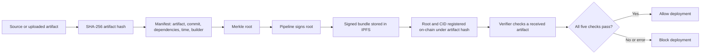

# Tamper-Proof CI/CD Artifact Provenance Ledger

This project checks whether a deployment artifact is exactly the artifact registered by an authorized build pipeline. Python packages the source, hashes the artifact, signs a Merkle root of its build manifest, stores the signed bundle in IPFS, and registers the root and CID in a Solidity contract. A separate verifier allows deployment only when every check passes.

The project includes a small command-line application and a local visual dashboard. It uses a **real local Ethereum chain and real local IPFS**, with no database or simulated blockchain in the application. It does not deploy or execute the verified ZIP: the verification exit code is the deploy gate.

For a complete feature explanation, presentation script, expected demo results, and viva questions, read [the faculty guide](docs/FACULTY_GUIDE.md). The implemented protocol and interfaces are documented in [Architecture](docs/ARCHITECTURE.md), [Manifest format](docs/MANIFEST_FORMAT.md), [Contract specification](docs/CONTRACT_SPEC.md), and [API reference](docs/API_SPEC.md).

## Workflow

An **artifact** is the file that would be deployed, such as a ZIP. A **manifest** is its build metadata. The **pipeline** is the trusted builder identity authorized by the contract owner.



The registration flow packages source into a deterministic ZIP, or accepts an existing file without repacking. It hashes the artifact, creates the manifest, builds its Merkle root, signs that root with the pipeline key, pins the signed bundle in IPFS, then submits a signed contract transaction. The original artifact remains outside IPFS; IPFS stores the signed provenance bundle.

The verification flow hashes the received file, looks up its record (or an explicitly selected approved hash), checks pipeline authorization, retrieves the bundle using its recorded CID, and checks artifact hash, manifest root, and signer. The browser and CLI use the same verification function.

| Displayed check | What it establishes |
|---|---|
| Registry lookup | A record exists for the lookup/approved artifact hash. |
| Pipeline authorization | The pipeline recorded in that build is still authorized. |
| Artifact fingerprint | Received SHA-256, manifest artifact hash, and lookup hash all match. |
| Manifest integrity | Recomputed root, bundle root, and on-chain root all match. |
| Signer identity | The signature recovers the on-chain pipeline address, consistent with the bundle and manifest builder. |

These identifiers have different meanings: **artifact hash** fingerprints the artifact; **Merkle root** commits to manifest entries; **CID** addresses the signed IPFS bundle; **transaction hash** identifies a chain transaction. One failed check blocks the overall result. A skipped check means verification did not reach it, not that tampering was proved there.

## Requirements

- Windows PowerShell, Node.js 20+ and npm.
- Python 3.12+.
- Kubo IPFS 0.32.1, either on PATH or extracted to `.tools/kubo/ipfs.exe`.
- Three terminals: local chain, local IPFS, and project commands.

## Setup

Run all commands from this project folder. On a fresh clone, install Python, Node.js, and Kubo first, then follow the commands below. Virtual environments, downloaded tools, keys, artifacts, and chain/IPFS databases are deliberately not included in Git. On an existing working setup, skip installation commands if `.venv`, `node_modules`, and `.tools/kubo` already exist.

```powershell
python -m venv .venv
.venv/Scripts/python.exe -m pip install -r requirements.txt
npm ci --omit=optional
npm run compile
```

If a project-local interpreter was previously downloaded on your machine, you can alternatively use it to create the environment (this optional interpreter is ignored by Git):

```powershell
& '.tools/python/cpython-3.12.13-windows-x86_64-none/python.exe' -m venv .venv
```

Kubo downloads and checksums are available at [the official distribution page](https://dist.ipfs.tech/kubo/v0.32.1/). Extract the Windows amd64 archive into `.tools` so `.tools/kubo/ipfs.exe` exists. Verify the ZIP against its published SHA-512 checksum before running it. Other platforms can run `ipfs init` and `ipfs daemon --offline` themselves.

In terminal 1:

```powershell
npm run chain
```

Ganache listens on `127.0.0.1:8545` with chain ID 1337 and persists data in `.data/chain`. Its deterministic accounts are public test accounts. Use only local test ETH.

In terminal 2:

```powershell
powershell -ExecutionPolicy Bypass -File scripts/start-ipfs.ps1
```

The script initializes an isolated repository in `.data/ipfs`, binds the API to `127.0.0.1:5001`, and starts Kubo offline. Offline mode still stores and retrieves real content-addressed IPFS objects; public peer replication is outside this demonstration.

For an existing configured workspace with a deployment file, keys, and persisted chain state, run `doctor` and skip the one-time commands below. For a fresh clone, run them once. Do not start a second copy of a service while its port is already in use.

In terminal 3:

```powershell
.venv/Scripts/python.exe ledger.py keygen
.venv/Scripts/python.exe ledger.py deploy
$pipelineAddress = (Get-Content keys/pipeline.address -Raw).Trim()
.venv/Scripts/python.exe ledger.py authorize $pipelineAddress --fund
.venv/Scripts/python.exe ledger.py doctor
```

`keygen` refuses to overwrite keys. `deploy` refuses to overwrite `contracts/deployment.json`. Run both once. The owner authorizes the newly generated pipeline address and sends it 1 test ETH for gas. Owner administration uses the local chain's unlocked deployer; pipeline registration transactions are signed locally.

## Register and verify

### Visual dashboard

Keep Ganache and IPFS running in terminals 1 and 2. In terminal 3:

```powershell
.venv/Scripts/python.exe -m web.server
```

Open [the local dashboard](http://127.0.0.1:8000). No frontend installation or build step is needed: it uses plain HTML, CSS, JavaScript, and Python's HTTP server.

- **Verify artifact:** upload any file up to 12 MiB, optionally choose an approved build, and inspect all five checks. “Use selected original” verifies a locally saved original without uploading it.
- **Create sample build:** packages the sample, signs it, pins it to IPFS, and registers it on-chain using the already-authorized local pipeline. Its commit hash is explicitly demo metadata.
- **Register uploaded artifact:** provide a real commit and optional dependency JSON; the pipeline signs the exact uploaded bytes without repacking. The UI does not expose the private key.
- **Tampering lab:** modify a ZIP member or append bytes to a temporary copy. The report shows changed member hashes, a byte offset, and a text diff for small UTF-8 files. Separate, clearly labeled manifest/signature simulations explain the later checks without altering real IPFS or chain records.
- **Merkle explorer:** select an entry and follow its sibling path to the on-chain root.
- **Build ledger:** read contract registration events, choose a build, and inspect provenance. Reports can be downloaded as JSON.

File comparisons require a locally available original whose SHA-256 matches the approved on-chain hash. A hash mismatch alone cannot identify the changed file, attacker, or time. ZIP metadata/compression changes may change the artifact hash while all member contents still match. Comparison is limited to 500 members / 32 MiB uncompressed; files are never extracted or executed. Text diffs are shown for modified UTF-8 members up to 64 KiB, limited to 120 diff lines. The byte offset is the first difference in the complete artifact, which may be a ZIP header rather than the changed source-code byte. The dashboard binds only to loopback, checks request Host/Origin, and is intended for a local classroom demonstration.

Suggested first visit: **Create sample build → Tampering lab → select that sample → Change a file → inspect the failed fingerprint and `app.py` diff → Merkle explorer → Build ledger**. Service indicators show Ganache and IPFS availability; use their refresh control after starting either service. Download report exports the current verification evidence as JSON. No actual software deployment is performed by the dashboard.

### Command line

```powershell
.venv/Scripts/python.exe ledger.py register examples/sample-app --output artifacts/app.zip --commit aaaaaaaaaaaaaaaaaaaaaaaaaaaaaaaaaaaaaaaa
.venv/Scripts/python.exe ledger.py verify artifacts/app.zip
.venv/Scripts/python.exe ledger.py tamper-demo artifacts/app.zip
```

The repeated `a` commit is **illustrative demo metadata**, not a real commit. For a real repository pass its full `git rev-parse HEAD` value. The pipeline attests the commit metadata; the ledger does not independently prove the source was checked out from that commit.

Registration prints the artifact hash, Merkle root, CID, pipeline address, and transaction hash. Verification prints `passed: true` and each successful check. The tamper demo prints a clean PASS followed by a modified-copy FAIL; its artifact hash check fails while the original manifest root and signature still pass. The demo command returns success when the attack was correctly blocked.

Normal verification returns exit code **0 for allowed** and **1 for blocked/error**. For a CI gate:

```powershell
.venv/Scripts/python.exe ledger.py verify artifacts/app.zip
if ($LASTEXITCODE -ne 0) { throw 'Deployment blocked' }
# A real deployment command would go here.
```

An altered artifact normally has no record under its new hash. To show the exact mismatch against an approved build, use `verify ... --expected-hash <original SHA-256>`. A deployment system must pin an approved hash to prevent substitution with a different, legitimately registered build.

The same artifact bytes cannot be registered twice. For a repeatable classroom demonstration after initial setup:

```powershell
powershell -ExecutionPolicy Bypass -File scripts/demo.ps1
```

This creates a new sample build with a build ID each time. It does not modify the sample source or earlier artifacts. Repeating `tamper-demo` on exactly the same artifact refuses to overwrite its existing tampered copy.

## Dependencies and inclusion proofs

The sample has no third-party dependencies. For another application, pass `--dependencies path/to/dependencies.json` containing entries like:

```json
[{"name":"example-library","version":"1.0","hash":"0123456789abcdef0123456789abcdef0123456789abcdef0123456789abcdef"}]
```

Use the SHA-256 of the actual dependency file, not a made-up value. Dependency metadata is supplied by the pipeline, sorted by name, and committed into the tree. The verifier authenticates this metadata; it does not download or audit dependencies.

```powershell
.venv/Scripts/python.exe ledger.py proof <artifact-hash> --index 4
```

The command fetches the registered bundle, generates a proof, and checks the selected leaf against the on-chain root. Leaf indices 0–3 are version, artifact name, artifact hash, and commit. Dependencies start at 4; timestamp and builder follow. With no dependencies, index 4 is timestamp. The proof itself only needs one leaf, its siblings, and the trusted root; this convenience command fetches the manifest to generate it.

## Files and concepts

| Location | Responsibility |
|---|---|
| `build/` | Chunked SHA-256, deterministic ZIP, canonical validated manifest |
| `merkle/` | Ordered leaves, binary tree, inclusion proofs |
| `sign/` | Ethereum key generation and EIP-191 root signatures |
| `ipfs/` | Kubo upload, fetch, and returned-content CID check |
| `contracts/` | Append-only Solidity registry, access control, Web3 client |
| `verify/` | Configuration and the two end-to-end flows |
| `ledger.py` | Small CLI joining the modules |
| `web/` | Local HTTP API, evidence inspection, ZIP comparison, and browser frontend |
| `tests/` | Core, failure-path, and real-node integration tests |
| `docs/` | Architecture, exact formats, module interfaces, faculty walkthrough |
| `keys/` | Generated local pipeline secret and address; ignored by Git |
| `mds/` | Local original planning notes, ignored by Git; published implementation docs live in `docs/` |

## Testing

```powershell
.venv/Scripts/python.exe -m pytest -q
# With both nodes running and contract compiled:
$env:LEDGER_INTEGRATION = '1'
.venv/Scripts/python.exe -m pytest -q
Remove-Item Env:LEDGER_INTEGRATION
```

The full suite has 35 tests. The core tests can run without services (integration tests are skipped by default). The contract integration test deploys a separate temporary registry and uses temporary keys. It checks actual contract events, owner restrictions, authorized writes, duplicate rejection, zero inputs, removal, IPFS round-trip/content addressing, and clean/tampered verification. The dashboard integration test additionally requires the one-time project setup above: it uses the configured pipeline and registry, adds new sample/upload registrations, and checks all four lab scenarios. It does not alter the main registry's permissions. Run integration tests against the local demo environment. See `docs/FACULTY_GUIDE.md` for the presentation flow.

`requirements.txt` pins direct dependencies; `requirements-lock.txt` records all installed Python packages from the verified Windows environment. For an exact Windows reinstall, install the lock file instead. `package-lock.json` locks npm dependencies. Ganache may print a native WebSocket compatibility warning on Node 24 and fall back to its working JavaScript implementation. The development tool dependency tree also reports upstream npm audit findings; these pinned local tools are not a production deployment stack.

## Configuration and troubleshooting

Use global options **before the subcommand**: `--rpc`, `--ipfs`, `--deployment`, `--key`. Environment defaults: `LEDGER_RPC_URL`, `LEDGER_IPFS_API_URL`.

- Chain offline: start terminal 1. IPFS unavailable: start terminal 2. `doctor` checks both and the deployed contract.
- Missing compiled contract: run `npm run compile`. Missing deployment: run `deploy` once.
- Unauthorized pipeline: authorize the address in `keys/pipeline.address`. Insufficient funds: use a local test ETH transfer.
- Existing artifact: change the sample source or use the repeatable demo; overwriting provenance is forbidden.
- Chain reset: old deployment files are no longer valid. Preserve/rename the old deployment file and deploy to a new `--deployment` path, then authorize again. The client checks chain ID and deployed bytecode.

## Trust and limitations

The trusted anchors are the chosen chain/RPC, the local deployment file, the contract owner, and authorized pipeline private keys. Keep `keys/` private; the development key file is unencrypted and should be replaced with a secret manager in production. Private keys are never sent to IPFS. Windows key-file access also depends on the user's directory ACLs.

The verifier compares the signature's recovered address with the **on-chain pipeline address**, never an arbitrary public key from the uploaded bundle. Removing a pipeline blocks its historical builds at verification time, but records remain readable and unchanged. This is pipeline-level revocation; per-build revocation is future work.

A compromised authorized pipeline can register malicious artifacts. Provenance proves identity and integrity, not safety, reproducibility, source correctness, or freshness. Local Ganache does not provide production consensus security, and local offline IPFS provides no replication guarantee. SHA-256 and signatures do not protect an untrusted verifier host or compromised RPC. Large artifacts remain off-chain; manifests are limited to 2 MiB. Actual CI hooks, Docker builds, testnet deployment, production web hosting, and on-chain signature validation are outside this scope.

## References

- [Kubo RPC API: add and cat](https://docs.ipfs.tech/reference/kubo/rpc/)
- [Web3.py contract API](https://web3py.readthedocs.io/en/stable/web3.contract.html)
- [eth-account signing and recovery](https://eth-account.readthedocs.io/en/v0.13.7/eth_account.html)
- [Solidity documentation](https://docs.soliditylang.org/en/v0.8.24/)
- The implementation documentation in `docs/`; original local planning notes in `mds/` are excluded from Git.

## Publishing the source

The `.gitignore` excludes `mds/`, private keys, generated artifacts, virtual environments, downloaded tools, npm dependencies, caches, chain/IPFS runtime data, compiled contract output, deployment metadata, and `.env`. Keep the Python/Solidity/frontend source, `docs/`, sample source, scripts, tests, dependency manifests, and lock files in the repository.

Before committing, review `git status --short` and `git diff --cached --stat`. Do not use `git add -f` for ignored runtime or secret files. A clean clone will create its own keys, compile and deploy its own contract, and build its own local history by following Setup.

Ignore rules do not remove files that Git already tracks. If `mds/` was tracked in another checkout, use `git rm -r --cached -- mds` there to remove it from the index while keeping the local notes. If a private key was ever committed, removing it in a later commit does not remove it from earlier history; replace that identity before any non-demo use.
