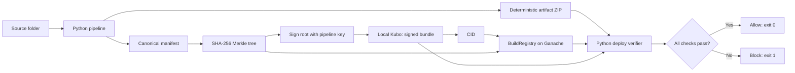

# Implemented architecture

The contract maps artifact SHA-256 to immutable records. Only the owner may add/remove pipeline addresses, only authorized pipelines may register, and anyone may read. No record can be overwritten. Events provide the registration and permission-change history.

The pipeline signs both the root message and the Ethereum registration transaction using the same generated identity. The verifier recovers the root signer and compares it against the registering pipeline. Bundle signer metadata is checked for consistency, never used as an independent trust anchor.

The verifier computes the actual artifact hash, selects its on-chain record (or an explicitly approved expected hash), checks current pipeline authorization, fetches the bundle by recorded CID, checks returned bytes against that CID using Kubo's import rules, validates the manifest, rebuilds the root, and verifies the signature. It reports individual booleans and blocks on all exceptions. False booleans after an early error can mean a check was not reached; read `reason`.

Trust: local deployment file, selected RPC/chain, owner and pipeline private key. Untrusted: artifact store and bundle metadata. Local Kubo is trusted to implement CID hashing correctly; the independent root/signature checks still authenticate provenance. Local chain state can be reset by its operator, so production immutability is not claimed.

## Local visual interface

`web/static` is a framework-free HTML/CSS/JavaScript frontend. `web/server.py` serves it and the JSON API from the same loopback origin. It calls the existing pipeline and verifier directly, so the CLI and browser share one deploy gate. The dashboard adds upload handling, contract-event history, ZIP comparisons against hash-validated local originals, and proof-path presentation. Uploaded artifacts are registered without repacking through `register_artifact`.

Tampering lab artifact scenarios operate on temporary copies. Manifest/signature scenarios deliberately overlay a corrupted fetched response to demonstrate later checks; these are labeled simulations and do not write altered bundles to IPFS. Local-only API origin checks prevent another website from invoking pipeline writes through the browser. This is a classroom interface with no production multiuser authentication or external hosting.
